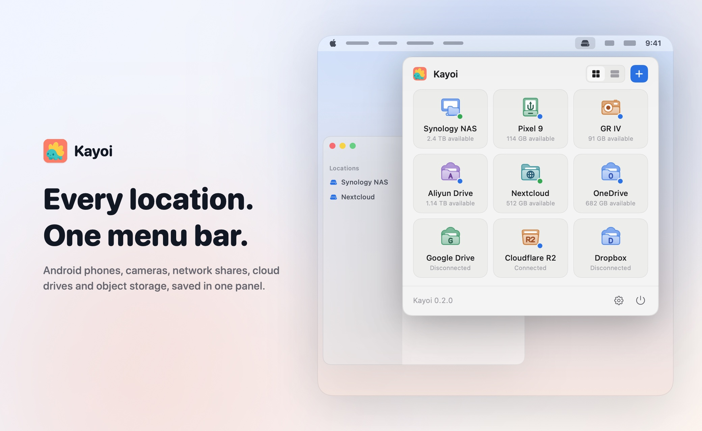

<div align="center">

<a href="https://github.com/Seaony/Diskit/releases/latest"></a>

# Diskit

### Every location. One menu bar.

**Android phones, cameras, network shares, cloud drives and object storage, saved in one panel.**<br>
Click the menu bar icon to see what's connected and how much space is left,<br>
and mount your shares in Finder with one click.

  

**[Download](https://github.com/Seaony/Diskit/releases/latest)** &nbsp;·&nbsp; **[Releasing](docs/RELEASING.md)** &nbsp;·&nbsp; **English** · [简体中文](README.zh-CN.md)

<br>

<picture>
  <source media="(prefers-color-scheme: dark)" srcset="docs/assets/product-dark-en.jpg">
  
</picture>

</div>

<br>

## Is Diskit for you?

Your files live in many places: a NAS at home, a phone on your desk, a camera in your bag, a few cloud drives and a storage bucket. Each one has its own app, its own sign-in and its own way to connect, and you end up looking them up again every time.

Diskit keeps them all in one panel in the menu bar:

- **See everything at a glance**: each location is a card with its status and free space. Switch between cards and a compact list.
- **Mount shares in one click**: SMB, WebDAV and NFS shares mount in Finder and stay there until you eject them.
- **Connect phones and cameras without extra apps**: Diskit speaks ADB itself, over USB or wireless debugging, and reads cameras through macOS.
- **Keep secrets in the Keychain**: passwords, tokens and cookies never go into a config file.

It's for you if you move files between several devices and services. If everything you use already lives in one cloud drive with its own Mac app, you don't need it.

> [!NOTE]
> Diskit is early. SMB, WebDAV and NFS mount through macOS; phones, USB cameras, cloud drives and object storage mount in Finder through Diskit's own file system extension, which you turn on once in System Settings when the panel asks. Many integrations have not been checked against real accounts and devices yet.

## Quick start

**1 · Install.** Download the DMG from the **[latest release](https://github.com/Seaony/Diskit/releases/latest)**, open it and drag `Diskit.app` into Applications.

<sub>Builds are universal (Apple silicon and Intel) and need macOS 26 or later. Diskit updates itself from GitHub Releases through Sparkle.</sub>

**2 · Add a location.** Click the Diskit icon in the menu bar, press **+**, pick a type and fill in what it asks for. Devices and shares Diskit finds on your network or USB appear first. Press **Test and Save**.

**3 · Use it.** Click a card for its actions: mount or eject, test again, edit, reorder or delete. Mounted locations show up in Finder's sidebar under Locations.

## Supported locations

<table>
<tr><td><b>Devices</b></td><td>Android phone (USB) · Android phone (wireless debugging) · USB cameras</td></tr>
<tr><td><b>Shares</b></td><td>SMB · WebDAV (HTTP and HTTPS, with presets for Jianguoyun, Nextcloud, ownCloud, Synology, QNAP and OpenList) · NFS</td></tr>
<tr><td><b>Experimental drives</b></td><td>Quark Drive · UC Drive · Tianyi Cloud · Mobile Cloud · Xunlei Drive · PikPak · Lanzou Cloud (read-only)</td></tr>
<tr><td><b>Object storage</b></td><td>Amazon S3 · Cloudflare R2 · Alibaba Cloud OSS · Tencent Cloud COS · Qiniu Kodo · MinIO · Backblaze B2</td></tr>
</table>

Experimental drives sign in through the provider's website or with your account and password, and use unofficial interfaces, so they may stop working when the provider changes its site.

## What it does

### A panel, not another window

Diskit lives in the menu bar with no Dock icon. The panel shows every saved location as a card or a row, with a status dot and the space left. Drag to reorder, right-click for actions, and use the keyboard: arrow keys to select, Return for the main action, ⌘N to add, ⌘E to edit. The menu bar icon fills in when something is mounted and flags locations that need attention.

### Shares in Finder

SMB, WebDAV and NFS shares mount through macOS, so Finder and every other app see them as normal volumes. Diskit can list the shares on an SMB server, checks your password before saving, and leaves system mounts in place when you quit.

### Phones and cameras

Android phones connect over USB debugging or Android 11+ wireless debugging with a pairing code. Diskit implements the ADB protocol itself, so there's no `adb` to install and nothing to add to the phone. USB cameras are read through macOS Image Capture; their photos stay untouched unless the camera allows deleting.

### Built for macOS

Native SwiftUI and AppKit. Light and dark appearance. English and Simplified Chinese. Launch at login and in-app updates.

## Privacy

- Passwords, tokens and cookies are stored in your login Keychain.
- Saved locations live in `~/Library/Application Support/Diskit/connections.json`, without any secrets. Caches stay in `~/Library/Caches/Diskit/`, and error logs are kept for 7 days.
- Diskit has no analytics. Besides looking for phones, cameras and shares on your local network and over USB, it talks only to the devices and services you add, and to Diskit's GitHub Releases feed for updates.

## Build from source

You need Xcode 27 and XcodeGen (`brew install xcodegen`).

```sh
git clone https://github.com/Seaony/Diskit.git
cd Diskit
make build
open build/DerivedData/Build/Products/Debug/Diskit.app
```

`make build` uses Xcode automatic signing for the paid development team configured in `project.yml`. It builds the provisioned Debug app used for M7 acceptance. The current `make release` still removes the FSKit extension; packaging a provisioned release is a separate step. Each process checks whether shared storage works and keeps using legacy storage if it does not.

`make test` runs the tests, and `make dev-tool SIGN_IDENTITY='Apple Development'` builds `build/bin/diskit-dev`. The tool forwards its commands to the built Debug app or an installed compatible Diskit app, preserving arguments, output and exit status. Open the provisioned Debug app once to migrate existing data before using shared storage from the tool. See [docs/DEVELOPMENT.md](docs/DEVELOPMENT.md) for storage paths and command-line setup, and [docs/RELEASING.md](docs/RELEASING.md) for releases.

## Acknowledgements

The panel design takes its cue from [SideMount](https://sidemount.app/). ADB follows [AOSP](https://android.googlesource.com/platform/packages/modules/adb/), wireless pairing uses [BoringSSL](https://boringssl.googlesource.com/boringssl/), and several cloud drive behaviours were checked against [rclone](https://github.com/rclone/rclone). Updates use [Sparkle](https://sparkle-project.org/). See [docs/THIRD_PARTY_NOTICES.md](docs/THIRD_PARTY_NOTICES.md) for the full list.

## License

[MIT](LICENSE). Third-party code keeps its own license; see [docs/THIRD_PARTY_NOTICES.md](docs/THIRD_PARTY_NOTICES.md).

---

<div align="center">
  <sub>Wherever your files live, one click from the menu bar.</sub>
</div>
