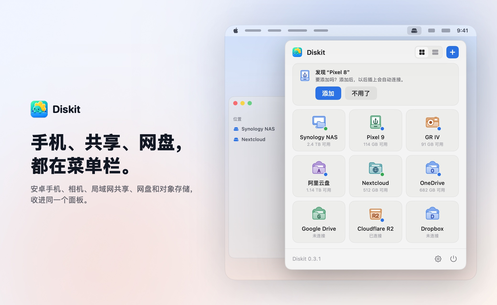

# Diskit

### 手机、共享、网盘，都在菜单栏。

**安卓手机、相机、局域网共享、网盘和对象存储，收进同一个面板。** 
点一下菜单栏图标，就能看到哪些已连接、还剩多少空间， 
共享一键挂载到 Finder。

  

**[下载](https://github.com/Seaony/Diskit/releases/latest)** &nbsp;·&nbsp; [English](README.md) · **简体中文**

 

<picture>
  <source media="(prefers-color-scheme: dark)" srcset="docs/assets/product-dark-zh.jpg">
  
</picture>

 

## Diskit 适合你吗？

文件散在很多地方：家里的 NAS、桌上的手机、包里的相机，还有几个网盘和一个存储桶。每个都有自己的 App、自己的登录和自己的连接方式，每次用都要重新找一遍。

Diskit 把它们都放进菜单栏的一个面板里：

- **一眼看清**：每个位置是一张卡片，显示状态和剩余空间；也可以切换成紧凑的列表。
- **共享一键挂载**：SMB、WebDAV、NFS 共享挂载到 Finder，推出之前一直都在。
- **手机和相机不用装别的 App**：Diskit 自己实现了 ADB，支持 USB 和无线调试；相机通过 macOS 读取。
- **密钥只放钥匙串**：密码、令牌和 Cookie 不会写进配置文件。

如果你经常在多台设备和多个服务之间倒腾文件，它适合你。如果你只用一个网盘，而且它已经有自己的 Mac App，就不需要它。

> [!NOTE]
> Diskit 还在早期。SMB、WebDAV、NFS 通过系统挂载；手机、USB 相机、网盘和对象存储通过 Diskit 自带的文件系统扩展挂载到 Finder，第一次挂载前按面板上的提示在系统设置里打开它。很多接入还没有用真实账号和设备验证过。

## 快速开始

**1 · 安装。** 从 **[最新版本](https://github.com/Seaony/Diskit/releases/latest)** 下载 DMG，打开后把 `Diskit.app` 拖进“应用程序”。

安装包同时支持 Apple 芯片和 Intel，需要 macOS 26 或更高版本。Diskit 通过 Sparkle 从 GitHub Releases 自动更新。

**2 · 添加位置。** 点菜单栏的 Diskit 图标，按 **+**，选择类型并按提示填写。局域网和 USB 上已发现的设备和共享会排在最前。按 **测试并保存**。

**3 · 开始使用。** 点卡片打开操作：挂载或推出、重新测试、编辑、排序或删除。挂载后的位置会出现在 Finder 侧栏的“位置”里。

## 支持的位置

<table>
<tr><td><b>设备</b></td><td>安卓手机（USB） · 安卓手机（无线调试） · USB 相机</td></tr>
<tr><td><b>共享</b></td><td>SMB · WebDAV（HTTP 和 HTTPS，内置坚果云、Nextcloud、ownCloud、群晖、威联通和 OpenList 预设） · NFS</td></tr>
<tr><td><b>实验性网盘</b></td><td>夸克网盘 · UC 网盘 · 天翼云盘 · 移动云盘 · 迅雷云盘 · PikPak · 蓝奏云（只读）</td></tr>
<tr><td><b>对象存储</b></td><td>Amazon S3 · Cloudflare R2 · 阿里云 OSS · 腾讯云 COS · 七牛 Kodo · MinIO · Backblaze B2</td></tr>
</table>

实验性网盘通过服务商网页或账号密码登录，使用非官方接口，服务商改版后可能暂时失效。

## 功能

### 一个面板，不是又一个窗口

Diskit 常驻菜单栏，不占 Dock。面板把每个已保存的位置显示成卡片或一行，带状态点和剩余空间。可以拖动排序、右键操作，也可以用键盘：方向键选择，回车执行主操作，⌘N 添加，⌘E 编辑。有共享挂载时菜单栏图标会变成实心，有位置需要处理时会带上提醒标记。

### 共享进 Finder

SMB、WebDAV、NFS 共享通过 macOS 挂载，Finder 和其他 App 都把它们当作普通的盘。Diskit 能列出 SMB 服务器上的共享，保存前会先验证密码；退出 Diskit 时保留系统挂载。

### 手机和相机

安卓手机通过 USB 调试连接，Android 11 及以上也可以用配对码走无线调试。Diskit 自己实现了 ADB 协议，不用安装 `adb`，手机上也不用装任何东西。USB 相机通过 macOS 的图像捕捉读取；除非相机允许删除，否则不会改动照片。

### 为 macOS 而做

原生 SwiftUI 和 AppKit。支持浅色和深色外观，支持简体中文和英文。可以开机启动，可以在应用内更新。

## 隐私

- 密码、令牌和 Cookie 保存在登录钥匙串里。
- 已保存的位置在 `~/Library/Application Support/Diskit/connections.json`，不含任何密钥。缓存在 `~/Library/Caches/Diskit/`，错误日志保留 7 天。
- Diskit 不做任何统计。除了在局域网和 USB 上发现手机、相机和共享，它只和你添加的设备、服务通信，以及访问 Diskit 的 GitHub Releases 检查更新。

## 致谢

面板设计参考了 [SideMount](https://sidemount.app/)。ADB 依照 [AOSP](https://android.googlesource.com/platform/packages/modules/adb/) 实现，无线配对使用 [BoringSSL](https://boringssl.googlesource.com/boringssl/)，部分网盘行为参照 [rclone](https://github.com/rclone/rclone) 核对。自动更新使用 [Sparkle](https://sparkle-project.org/)。完整清单见 [docs/THIRD_PARTY_NOTICES.md](docs/THIRD_PARTY_NOTICES.md)。

---

  文件在哪，都只差菜单栏上的一次点击。

